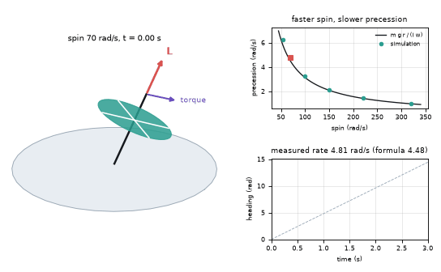
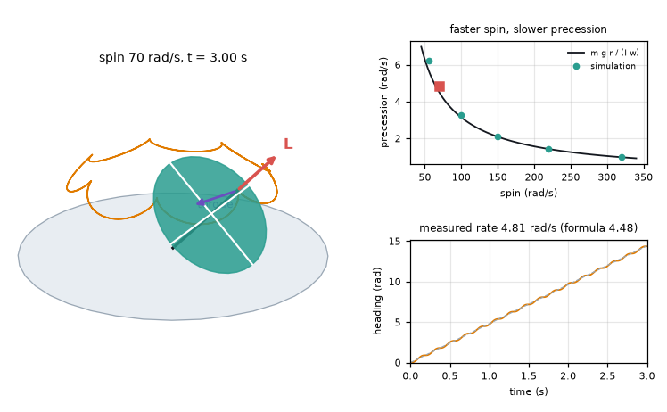
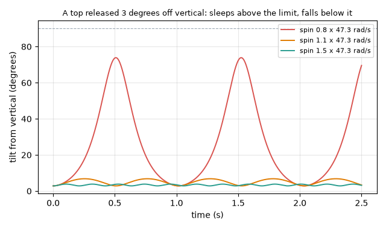
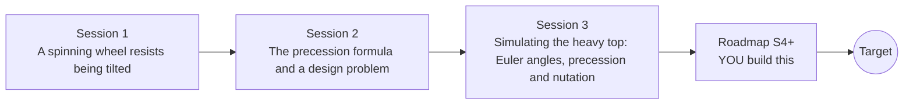

# opengyro

[](https://github.com/KrunalPanchal1995/opengyro/actions/workflows/ci.yml)   [](https://colab.research.google.com/github/KrunalPanchal1995/opengyro/blob/main/sessions/session-01/lesson.ipynb) [](https://krunalpanchal1995.github.io/opengyro/)

**Why a spinning top does not fall: torque, angular momentum and precession, in three sessions.**

opengyro teaches rotational motion from a spinning wheel to a simulated heavy top, using only Python and a browser, and shows you where it leads.

- **Start from a wheel.** Session 1 needs only the idea of a push and a turn; arrows show angular momentum and torque.
- **See it move.** Every session ships a slider app that runs in the browser, with labelled graphs.
- **Know you got it right.** Each session ends with a checkpoint that prints PASS or FAIL against hand calculations and conserved quantities.
- **Build the missing half.** The repo stops at Session 3 on purpose; the roadmap shows the path to the Target.

[Target](#the-target) · [Who is this for](#who-is-this-for) · [Quick start](#quick-start) · [Sessions](#sessions) · [Roadmap](#roadmap) · [Contribute](#contribute) · [Explainer PDF](docs/explainer.pdf)

> **This repo is incomplete on purpose.** Sessions 1 to 3 are here and fully working. The finished Target below is a preview of what the community can build next. We show you the path, not the code. Sessions 4 and up are yours.

## The Target

A heavy top in a 3D-looking view, simulated with the full body-frame Euler equations and a quaternion for its attitude. The orange trace is the tip of the axis: slow circles (precession) with small loops (nutation). The red arrow is the angular momentum L and the purple one the gravity torque; the plot on the right shows the simulated precession rate lying on the m g r / (I w) curve, and the lower plot the heading growing steadily. Your goal over the coming sessions: build this top yourself, then add a spin-down and see it start to wobble.



*Target: a heavy top in 3D with its tip trace, angular momentum arrow and precession-rate plots*



*Target, final frame: precession loops, torque and angular momentum arrows*



*A top released 3 degrees off vertical sleeps above the classical limit and falls below it*

Try it live:

- [Math Visual Studio: rigid-body dynamics (Atlas S46)](https://krunalpanchal1995.github.io/studio/#atlas?ch=S46&ex=1)
- [Math Visual Studio: tensor calculus for mechanics (Atlas S84)](https://krunalpanchal1995.github.io/studio/#atlas?ch=S84&ex=1)

How the Target was made is shown only as a path in [promo/roadmap.md](promo/roadmap.md).

## Who is this for
**secondary school to diploma / undergraduate (levels 3-5).** Topic area: Physics and the Science of Motion.

Prerequisites:

- Forces and Newton's second law (F = m a); the idea of a turning effect (moment of a force).
- Sine and cosine of an angle; Python 3.10 or newer (`python --version`). PRIMER.md explains the rest.
- Calculus and Lagrangians are met only in Session 3 and are explained there step by step.

New to Python? Read [PRIMER.md](PRIMER.md) first (10 minutes).

## Quick start

No installation knowledge needed. You need [Git](https://git-scm.com/downloads) and [Python 3.10+](https://www.python.org/downloads/) (Windows: tick "Add Python to PATH"). On Mac and Linux type `python3` wherever this page says `python`.

```bash
git clone https://github.com/KrunalPanchal1995/opengyro.git
cd opengyro
python start.py 1
```

`start.py` creates a private environment, installs what is needed and runs Session 1 with its checkpoint. Next: `python start.py 2`, `python start.py 3`, or `python start.py test` to check everything. Only a checkpoint: `python start.py check 1`.

A few lines turn the idea of Session 2 into a result (they work as they are): Save it as `try.py` and run it with `python start.py run try.py` (this uses the private environment, where NumPy is installed):

```python
import numpy as np
m, R, r, g = 2.0, 0.30, 0.25, 9.81         # wheel mass, radius, lever arm, gravity
I = m * R ** 2 / 2                           # solid disc: I = m R^2 / 2
w = m * g * r * 4.0 / (2 * np.pi * I)        # spin that gives one circle every 4 s
print(round(w, 1), round(w * 60 / (2 * np.pi)))   # -> 34.7 331  (rad/s, rpm)
```

Every session also opens in your browser with sliders (no install): [live apps](https://krunalpanchal1995.github.io/opengyro/). Or use the Colab badge above for the notebook.

## Sessions

| # | Session | Model level | Time | Live app |
|---|---|---|---|---|
| 1 | [A spinning wheel resists being tilted](sessions/session-01/README.md) | Level 1: conceptual interactive model | 60 min | [open](https://krunalpanchal1995.github.io/opengyro/session-01/) |
| 2 | [The precession formula and a design problem](sessions/session-02/README.md) | Level 2: mathematical engineering model | 75 min | [open](https://krunalpanchal1995.github.io/opengyro/session-02/) |
| 3 | [Simulating the heavy top: Euler angles, precession and nutation](sessions/session-03/README.md) | Level 3: simulation and validation | 90 min | [open](https://krunalpanchal1995.github.io/opengyro/session-03/) |

Each session follows the same six steps: A real-world problem, B concept and theory, C visual explanation, D interactive simulation, E worked example and experiment, F assessment and design challenge. Each ends with `checkpoint.py`, which prints `PASS` or `FAIL` against reference numbers. Session 3 also contains the real-world mini-project: **Tune a gyroscope to precess at a target rate**.

## Architecture



| Folder or file | What is inside |
|---|---|
| `sessions/` | three sessions: README (A-F), `lesson.py`, notebook, live app, exercises, activity sheet, checkpoint |
| `promo/` | the Target: media, live links, and the roadmap (path only) |
| `docs/` | `explainer.tex` and the built `explainer.pdf` |
| `tests/` | runs every lesson and checkpoint headless |
| `start.py` | one command to set up and run anything |
| `QUALITY.md`, `RUBRIC.md` | the quality checklist and the scoring rubric |
| `.github/` | CI, PDF build, Pages deploy, issue and PR templates |

## Roadmap

| Milestone | What you will build | Difficulty |
|---|---|---|
| Session 4: A top that can start exactly vertical | The same top integrated with a quaternion for the attitude and the body-frame Euler equations. | intermediate |
| Session 5: Predict the mean precession from the effective potential | A function that predicts the nutation range and the mean precession rate without running the time loop. | advanced |
| Session 6: Spin-down and the start of the wobble | A simulation in which the spin decays exponentially (time constant 8 s) from 100 rad/s. | advanced |
| Session 7: A 3D view with the tip trace | An animated top with the trace of the axis tip, the L arrow and a live precession plot. | advanced |
| Session 8: Torque-free tumbling: the tennis racket effect | A body with three different moments of inertia simulated with the Euler equations. | advanced |

Full detail with a checkpoint per milestone: [promo/roadmap.md](promo/roadmap.md).

## Contribute
New to GitHub? Read [CONTRIBUTING.md](CONTRIBUTING.md); it starts from zero. Pick an issue labelled `good first issue`. Translations into Hindi, Telugu, Tamil and Malayalam are welcome.

<details>
<summary>Development</summary>

```bash
python start.py test        # runs every lesson and checkpoint
```
Lessons use `# %%` cell markers so they open as notebooks in VS Code. See [QUALITY.md](QUALITY.md) for the standard every session meets.
</details>

## License
MIT. See [LICENSE](LICENSE). Media in `promo/media` is (c) Krunal Panchal, CC BY 4.0.

## Acknowledgments
Part of the [PAN IIT OSS](https://hellofoss.tech-iitb.org/projects) open-source teaching collection, modelled on the structure of [openspline](https://github.com/openspline/openspline). Built on ideas from the Math Visual Studio at https://krunalpanchal1995.github.io/studio/.
