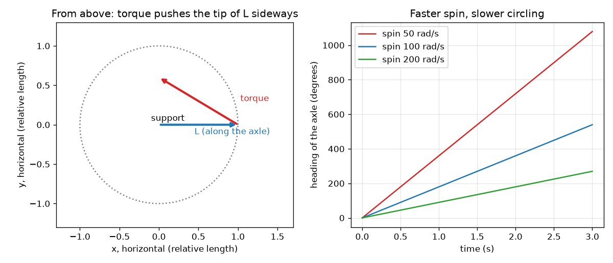

# Session 1: A spinning wheel resists being tilted

*Level 1 (conceptual interactive model) · about 60 minutes · opengyro*

> This is a simplified educational model. It is not a validated design tool and must not be used for real structures, electrical installations, vehicles, industrial processes or medical decisions.

**Prerequisites**

- Forces, and the idea that a force far from a pivot turns things more strongly.
- You have read PRIMER.md and run `python start.py 1` once.

**Learning objectives.** After this session you can:

- Describe the angular momentum arrow L of a spinning wheel and the torque arrow of gravity.
- Explain, with the two arrows, why a spinning wheel circles instead of falling.
- Compute L = I w and the gravity torque for a given wheel.
- Predict how the circling speed changes when the spin is doubled.

## A. Real-world problem
Hold a bicycle wheel by one end of its axle, with the axle horizontal. If the wheel is not spinning, the axle flops down at once. Get the wheel spinning fast and the axle stays up, and then does something odd: it swings slowly round in a horizontal circle. A spinning top does the same thing: it does not fall over while it spins, it slowly circles. Why does the wheel go sideways when gravity pulls it down? This is general education about everyday rotating objects; the models here are simplified.

## B. Concept and theory
A spinning wheel has angular momentum L, an arrow along its axle (right-hand rule: curl the fingers along the spin and the thumb gives the direction). Its size is L = I w, where w is the spin in radians per second and I is the moment of inertia: how hard the wheel is to spin up. A push that tries to turn the wheel is a torque, also an arrow. The rule that governs everything is: the change of L in a short time is the torque times that time. Gravity pulls the wheel's centre down, a distance r from the support. That gives a torque of size m g r that points sideways, at right angles to the axle (not down!). A change of L at right angles to L cannot make the arrow longer; it only turns it. So the axle swings round in a horizontal circle. The turning rate is torque divided by L, so a faster spin (bigger L) means a slower circling.

| Symbol | Meaning | Unit |
|---|---|---|
| w | spin of the wheel about its axle | rad/s |
| I | moment of inertia about the axle (disc: m R^2 / 2) | kg m^2 |
| L | angular momentum, L = I w | kg m^2/s |
| tau | torque of the weight about the support, m g r | N m |
| r | distance from the support to the wheel centre | m |
| Omega_p | circling rate of the axle (precession) | rad/s |

**Assumptions**

- The axle is horizontal and the wheel spins fast.
- No friction at the support or in the air.
- The wheel is a solid disc of mass 0.5 kg and radius 5 cm, with its centre 4 cm from the support.

$$ L = I\,w $$

$$ \tau = m g r $$

$$ \Delta \mathbf L = \boldsymbol\tau\,\Delta t $$

$$ \Omega_p = \frac{\tau}{L} $$

## C. Visual explanation
The left figure looks down from above. The blue arrow is L along the axle. The red arrow is the gravity torque: it sticks out sideways from the tip of L, so L moves in the direction of the red arrow, round a circle. The right figure plots the heading of the axle for three spin rates: all are straight lines (a constant circling rate), and a faster spin gives a flatter line, i.e. slower circling.

*Left: from above, the torque (red) pushes the tip of L (blue) sideways. Right: heading against time for three spin rates; a faster spin circles more slowly.*

## D. Interactive simulation
Run the lesson (`python start.py 1`), then open the live app: [Session 1: a wheel that circles](https://krunalpanchal1995.github.io/opengyro/session-01/) (or `app.html` in this folder). Drag the spin slider and watch how the L arrow turns by a smaller angle in the same time. Open the graph view and see the heading line get flatter when the spin grows.

**Challenge.** Choose a spin so that the axle makes one full circle in about 2 seconds.

## E. Worked example and experiment
**Problem.** For the wheel above (0.5 kg, radius 5 cm, centre 4 cm from the support) spinning at 100 rad/s, find L, the torque, the circling rate and the time for one circle.

1. I = m R^2 / 2 = 0.5 * 0.05^2 / 2 = 6.25e-4 kg m^2.
2. L = I w = 6.25e-4 * 100 = 0.0625 kg m^2/s.
3. tau = m g r = 0.5 * 9.81 * 0.04 = 0.1962 N m.
4. Omega_p = tau / L = 0.1962 / 0.0625 = 3.139 rad/s.
5. One circle is 2 pi radians, so it takes 2 pi / 3.139 = 2.00 s.

**Answer.** L = 0.0625 kg m^2/s, torque 0.1962 N m, circling 3.139 rad/s, one circle in 2.00 s. At 200 rad/s the same wheel circles at 1.570 rad/s (4.00 s).

**Experiment.** Hang a bicycle wheel from a rope tied to one end of its axle, spin it by hand and time one circle with a phone stopwatch; repeat for a slower and a faster spin. You should see slower circling for a faster spin. The model and the real wheel differ: the real wheel slows down by friction, so its circling speeds up as it spins down, and the rope and the hand add extra wobble.

## F. Assessment and design challenge
**Question type A: Conceptual.** Gravity pulls the wheel down. Why does the axle move sideways instead of down?

Hint

Which way does the torque of gravity point, and what does a change of L at right angles to L do to the arrow?

Step-by-step solution

The torque of the weight about the support is horizontal and at right angles to the axle. The rule says the change of L is the torque times the time, so L changes sideways. A sideways change of an arrow rotates it without changing its length, so the axle swings round horizontally. Without spin there is no L to steer, so gravity just tips the wheel down.

**Question type B: Numerical.** A wheel has I = 0.02 kg m^2 and spins at 50 rad/s. Find L. What is the circling rate if the torque of its weight is 0.30 N m?

Hint

L = I w, then Omega_p = torque / L. Check the units.

Step-by-step solution

L = 0.02 * 50 = 1.0 kg m^2/s. Omega_p = 0.30 / 1.0 = 0.30 rad/s, i.e. one circle in 2 pi / 0.30 = 20.9 s. Units: N m divided by kg m^2/s is 1/s, i.e. rad/s. Sanity check: a heavy wheel spun this fast circles slowly.

**Question type C: Graph and simulation interpretation.** In the heading graph, the line for 200 rad/s is half as steep as the line for 100 rad/s. What does that tell you about the relation between spin and circling rate?

Hint

Slope of the heading line is the circling rate.

Step-by-step solution

The slope is the circling rate and it is inversely proportional to the spin: doubling the spin halves the rate (3.139 to 1.570 rad/s). This follows from Omega_p = torque / (I w). A straight line means the rate is constant.

**Question type D: Design and optimisation challenge.** Design: you want the axle of this wheel to circle once every 2 seconds. Which spin do you need? Would it work for a person's hand-held spin of about 60 rad/s?

Hint

Required rate is 2 pi / 2 rad/s; then w = torque / (I Omega_p).

Step-by-step solution

Omega_p = 2 pi / 2 = 3.1416 rad/s, w = 0.1962 / (6.25e-4 * 3.1416) = 99.9 rad/s, about 100 rad/s (955 rpm). A hand spin of 60 rad/s gives one circle every 1.2 s, too fast. Trade-off: a faster spin needs a motor or a string pull; a heavier wheel (bigger I) reaches the same L at a lower spin.

Score yourself with [RUBRIC.md](../../RUBRIC.md). Print the [activity sheet](activity_sheet.md) to work on paper.

## Common misconceptions
| Common misconception | What is actually true |
|---|---|
| A spinning wheel should fall straight down, so something must be defying gravity. | Gravity does act: it makes a sideways torque and changes the direction of L. Energy and gravity are not violated; the axle just moves in a circle instead of down. |
| A torque always makes the wheel rotate about the torque arrow's direction in the picture. | The torque arrow shows the direction in which L changes. It is the arrow's tip that moves along the torque, not the wheel that turns about it. |
| A faster spin makes the wheel precess faster. | A faster spin makes L bigger, so the same torque turns it more slowly: precession is slower. |

## Glossary
- **angular momentum**: a measure of how much spinning motion a body has; an arrow along the axis, L = I w
- **torque**: the turning effect of a force, force times lever arm
- **precession**: the slow circling of the spin axis of a spinning body under a torque
- **moment of inertia**: how hard a body is to spin up; mass times distance squared, summed over the body

## Finish
1. Do the three coding tasks in [exercises.md](exercises.md).
2. Run `python start.py 1` again after your changes. It ends with the checkpoint; when it prints `PASS`, you are done. (Checkpoint only: `python start.py check 1`.)

Next: [Session 2](../session-02/README.md)
