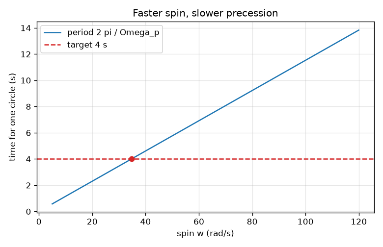
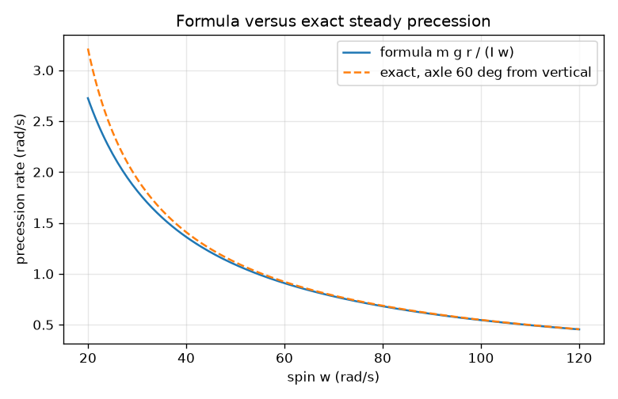

# Session 2: The precession formula and a design problem

*Level 2 (mathematical engineering model) · about 75 minutes · opengyro*

> This is a simplified educational model. It is not a validated design tool and must not be used for real structures, electrical installations, vehicles, industrial processes or medical decisions.

**Prerequisites**

- Session 1: L = I w and the idea of torque.
- Rearranging a formula; units of force, mass and length.

**Learning objectives.** After this session you can:

- Use L = I w, torque = dL/dt and the moment of inertia of a disc I = m R^2 / 2.
- Derive and use the fast-spin precession rate Omega_p = m g r / (I w), with its assumptions.
- Solve the design problem: choose the spin so a wheel precesses at a target rate.
- Explain why a faster spin gives slower precession and why the mass drops out for a disc.

## A. Real-world problem
A demonstrator holds a solid-disc wheel (mass 2 kg, radius 0.30 m) by an axle whose support is 0.25 m from the wheel centre. The wheel is spun and the axle swings slowly round. Can we choose the spin rate so that the axle makes exactly one circle every 4 seconds, and is that a spin a person can reach by hand? General education only: this is a simplified classroom model, not a design method for real machinery.

## B. Concept and theory
Newton's second law for rotation: the torque equals the rate of change of the angular momentum vector, tau = dL/dt. For a horizontal axle held at one end, the weight m g acts at the centre, r from the support, so tau = m g r, horizontal and at right angles to L. Then L keeps its size L = I w and only turns: in time dt it turns through the angle dphi = tau dt / L. So Omega_p = dphi/dt = tau / L = m g r / (I w). A solid disc has I = m R^2 / 2, so Omega_p = 2 g r / (R^2 w): the mass drops out. The formula needs a fast spin: the exact steady precession of a symmetric top at angle theta from the upward vertical solves I1 cos(theta) Omega^2 - I3 w Omega + m g r = 0 (derived in Session 3), where I1 = m R^2 / 4 + m r^2 for a disc about the support. It exists only when (I3 w)^2 >= 4 I1 m g r cos(theta); the fast-spin formula is the slow root when I3 w is much bigger than the square root of 4 I1 m g r. At a horizontal axle (theta = 90 degrees) the formula is exact. The fast-spin ratio (I3 w)^2 / (4 I1 m g r) tells how safely the formula applies.

| Symbol | Meaning | Unit |
|---|---|---|
| m | mass of the wheel | kg |
| R | radius of the wheel | m |
| r | distance from the support to the wheel centre | m |
| g | gravitational acceleration, 9.81 | m/s^2 |
| w | spin about the axle | rad/s |
| I | moment of inertia about the axle | kg m^2 |
| Omega_p | precession rate | rad/s |
| T | time for one circle, 2 pi / Omega_p | s |

**Assumptions**

- Fast spin: I w much larger than sqrt(4 I1 m g r); the spin stays steady (no friction).
- Small tilt effects are neglected: the wheel is a symmetric top whose axle stays at a steady angle, exactly horizontal in the design problem.
- The wheel is a solid disc; real bicycle wheels have most mass on the rim, with I closer to m R^2.
- The support is a frictionless point; the axle has negligible mass.

$$ I_{\mathrm{disc}} = \tfrac12 m R^2 $$

$$ \boldsymbol\tau = \frac{d\mathbf L}{dt},\qquad \tau = m g r,\qquad L = I w $$

$$ \Omega_p = \frac{m g r}{I w} = \frac{2 g r}{R^2 w}\quad\text{(solid disc)} $$

$$ w = \frac{m g r\,T}{2\pi I}\quad\text{(spin for one circle in time } T\text{)} $$

$$ I_1\cos\theta\,\Omega^2 - I_3 w\,\Omega + m g r = 0 $$

## C. Visual explanation
The first figure plots the time for one circle against the spin: a straight line through the origin, since T = 2 pi I w / (m g r), with the 4 second target as a horizontal line crossing it at 34.7 rad/s. The second figure compares the formula with the exact steady precession for an axle tilted 60 degrees from the vertical: the two curves approach each other as the spin grows, but at 34.7 rad/s the exact rate is 4.7 percent higher.

*Time for one circle against spin: a straight line; the target of 4 s needs 34.7 rad/s.*

*Precession rate against spin: formula versus exact steady precession for an axle tilted 60 degrees from the vertical.*

## D. Interactive simulation
Run the lesson (`python start.py 2`), then open the live app: [Session 2: precession of a wheel](https://krunalpanchal1995.github.io/opengyro/session-02/) (or `app.html` in this folder). Move the spin slider and see the period change in proportion. Change the mass and watch L and the torque grow but the period stay put (the disc's mass drops out). Then change the radius R and the lever arm r.

**Challenge.** Find a spin (m = 2 kg, R = 0.30 m, r = 0.25 m) that gives one circle in about 4 seconds, within 0.1 s.

## E. Worked example and experiment
**Problem.** Wheel: m = 2.0 kg, R = 0.30 m, r = 0.25 m, solid disc. Find the spin for one circle every 4 s, in rad/s and rpm, and check the result.

1. I = m R^2 / 2 = 2.0 * 0.09 / 2 = 0.0900 kg m^2.
2. Target rate: Omega_p = 2 pi / 4 = 1.5708 rad/s.
3. Torque: tau = m g r = 2.0 * 9.81 * 0.25 = 4.905 N m.
4. L = tau / Omega_p = 4.905 / 1.5708 = 3.123 kg m^2/s, so w = L / I = 3.123 / 0.0900 = 34.70 rad/s.
5. In rpm: 34.70 * 60 / (2 pi) = 331 rpm, about 5.5 turns per second.
6. Check: Omega_p = m g r / (I w) = 4.905 / (0.09 * 34.70) = 1.5708 rad/s, period 4.000 s. Half the spin gives 2.00 s, double gives 8.00 s.

**Answer.** w = 34.70 rad/s = 331 rpm (L = 3.123 kg m^2/s). The formula is exact for a horizontal axle; for an axle tilted 60 degrees from the vertical the exact rate at this spin is 1.644 rad/s instead of 1.571 (4.7 percent more).

**Experiment.** Use a bicycle wheel on a short handle, support it at one end of its axle, spin it with a string, and time one circle with a stopwatch while estimating the spin by counting spokes against a video frame rate. Expect the measured period to be shorter than the model by some percent: the wheel is rim-heavy (so I differs), friction slows the spin, and your hand adds torque. The model is a clean ideal; the wheel is not.

## F. Assessment and design challenge
**Question type A: Conceptual.** Why does a faster spin give a slower precession? And why does the mass not matter for a solid disc of fixed radius?

Hint

Omega_p = tau / L. What happens to each of tau and L when the spin or the mass changes?

Step-by-step solution

The torque of gravity is fixed by m g r, while L = I w grows with the spin, so the arrow L turns by a smaller angle each second. For a disc both the torque and I are proportional to m, so m cancels: Omega_p = 2 g r / (R^2 w). A heavier disc has a bigger torque but also resists being turned by exactly as much.

**Question type B: Numerical.** A solid-disc wheel with m = 1.0 kg, R = 0.20 m, r = 0.30 m spins at 50 rad/s about a horizontal axle. Find I, Omega_p and the time for one circle.

Hint

I = m R^2 / 2. Then Omega_p = m g r / (I w) and T = 2 pi / Omega_p.

Step-by-step solution

I = 1.0 * 0.04 / 2 = 0.020 kg m^2. Omega_p = 1.0 * 9.81 * 0.30 / (0.020 * 50) = 2.943 rad/s. T = 2 pi / 2.943 = 2.135 s. Units: N m divided by kg m^2/s is 1/s. Sanity check: 50 rad/s is only 8 turns per second, so a quick circle is plausible.

**Question type C: Graph and simulation interpretation.** In the period-versus-spin graph (m = 2 kg, R = 0.30 m, r = 0.25 m) the line passes through (34.7, 4). What is its slope, and what would the period be at 17 rad/s?

Hint

The line is T = 2 pi I w / (m g r), so the slope is T / w.

Step-by-step solution

Slope = 4 / 34.7 = 0.1153 s per (rad/s) (the formula gives 2 pi * 0.09 / 4.905 = 0.1153). At 17 rad/s T = 0.1153 * 17 = 1.96 s. The straight line through the origin says period is proportional to spin. But near and below about 20 rad/s this wheel has no steady precession when tilted, and the fast-spin ratio is close to 1, so the formula should not be trusted there.

**Question type D: Design and optimisation challenge.** Design: a real bicycle wheel has its mass on the rim, so I is about m R^2, twice the disc value. With the same m, R and r, what spin gives a 4 s circle? What stays the same? Which is easier to produce by hand, and what is the trade-off?

Hint

w = m g r T / (2 pi I). What does L = tau / Omega_p depend on?

Step-by-step solution

With I = 0.18 kg m^2: w = 4.905 * 4 / (2 pi * 0.18) = 17.35 rad/s = 166 rpm, half the disc value. L = tau / Omega_p = 3.123 kg m^2/s is the same: the target rate fixes L, and a larger I only lowers the spin needed. A hand can reach 166 rpm more easily than 331 rpm. Trade-off: the rim-heavy wheel is harder to spin up and to hold, and the fast-spin condition should be re-checked with the right I1.

Score yourself with [RUBRIC.md](../../RUBRIC.md). Print the [activity sheet](activity_sheet.md) to work on paper.

## Common misconceptions
| Common misconception | What is actually true |
|---|---|
| A heavier wheel precesses more slowly. | For a disc of fixed radius the mass cancels: Omega_p = 2 g r / (R^2 w). The radius and spin matter. |
| The formula is exact for any tilt and any spin. | It is exact for a horizontal axle and a good approximation for a fast spin; at slow spin the exact rate differs (4.7 percent at 60 degrees here) and below a limit there is no steady precession. |
| The moment of inertia is just the mass. | It also depends on how far the mass is from the axis (R squared): a rim-heavy wheel has twice the I of a disc of the same mass and radius. |

## Glossary
- **steady precession**: motion in which the axle turns at a constant rate at a constant tilt
- **fast-spin approximation**: assuming the spin is so fast that L is almost entirely along the axle
- **parallel axis theorem**: I about a parallel axis = I about the centre + m times distance squared
- **rpm**: revolutions per minute; 1 rad/s = 9.55 rpm

## Finish
1. Do the three coding tasks in [exercises.md](exercises.md).
2. Run `python start.py 2` again after your changes. It ends with the checkpoint; when it prints `PASS`, you are done. (Checkpoint only: `python start.py check 2`.)

Next: [Session 3](../session-03/README.md)
