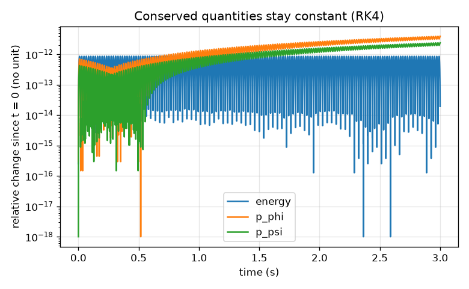
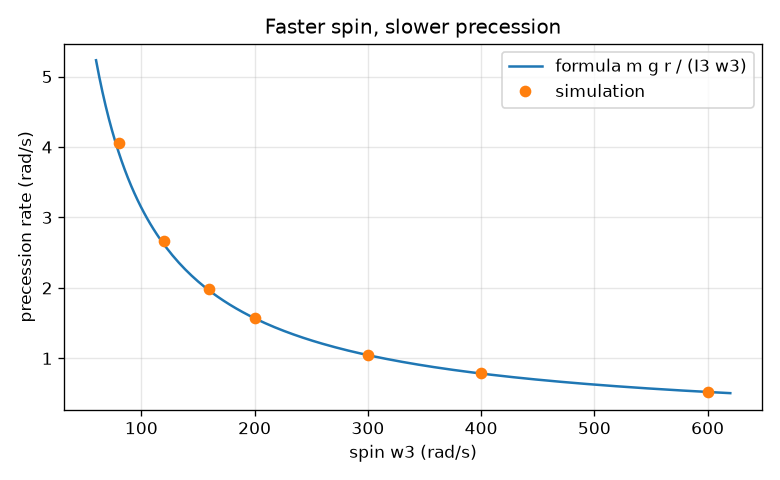
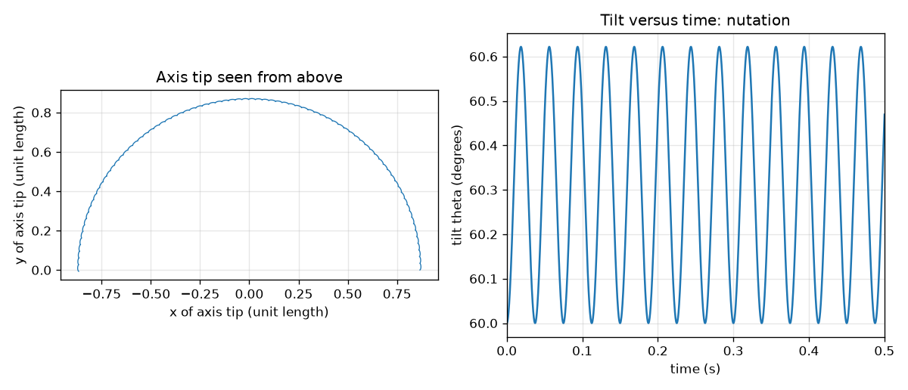

# Session 3: Simulating the heavy top: Euler angles, precession and nutation

*Level 3 (simulation and validation) · about 90 minutes · opengyro*

> This is a simplified educational model. It is not a validated design tool and must not be used for real structures, electrical installations, vehicles, industrial processes or medical decisions.

**Prerequisites**

- Session 2: L = I w, torque and the precession formula.
- Kinetic and potential energy; the idea of a derivative with respect to time. The Lagrangian is explained in Section B.

**Learning objectives.** After this session you can:

- State the Lagrangian of the heavy symmetric top in Euler angles and find its two conserved momenta.
- Integrate the equations with RK4 and validate with energy, p_phi and p_psi.
- Compare the simulated precession rate with m g r / (I3 w3) and measure the nutation frequency.
- Check the classical sleeping-top bound and recognise a top that falls over.

## A. Real-world problem
A toy top spun fast at a tilt does not fall: it circles slowly (precession) and shivers a little (nutation). Spun slowly it topples. Spun upright and fast enough it stands still, 'sleeping'. Can a simulation reproduce all three, and can we trust it? We do not experiment on a real top here: this is a frictionless textbook model, simplified, and real tops slow down and wobble because of friction.

## B. Concept and theory
A rigid body turns about a fixed point O (the tip). Three Euler angles describe it: theta is the tilt of the symmetry axis from the upward vertical, phi turns the axis around the vertical, and psi is the spin about the axis. The body is symmetric: I3 about the axis, I1 about any perpendicular axis through O. With w3 = psi' + phi' cos(theta) (the spin component along the axis) the kinetic energy is I1/2 (theta'^2 + phi'^2 sin^2 theta) + I3/2 w3^2 and the potential energy is m g r cos(theta), so the Lagrangian is L = T - V. The angles phi and psi do not appear in L, hence p_psi = I3 w3 and p_phi = I1 phi' sin^2 theta + I3 w3 cos(theta) are constant (Noether). The Lagrange equation for theta gives theta'' = phi'^2 sin(theta) cos(theta) - (I3/I1) w3 phi' sin(theta) + (m g r / I1) sin(theta), and differentiating p_phi gives phi''; psi'' follows from w3 constant. We integrate all with RK4 and then check that energy, p_phi and p_psi stay constant. For a fast spin the theory gives a slow precession Omega_p = m g r / (I3 w3) and a fast nutation at about w_n = I3 w3 / I1. A top that is nearly vertical is stable (sleeps) if w3^2 > 4 m g r I1 / I3^2: this is the standard classical stability bound for a vertical top, which we verify numerically rather than derive.

| Symbol | Meaning | Unit |
|---|---|---|
| theta, phi, psi | Euler angles: tilt, turn about the vertical, spin about the axis | rad |
| w3 | spin component along the axis, psi' + phi' cos(theta) | rad/s |
| I3, I1 | moments of inertia about the symmetry axis and a perpendicular axis through the tip | kg m^2 |
| m g r | largest gravity torque (r: tip to centre of mass) | N m |
| p_phi, p_psi | conserved angular momentum components | kg m^2/s |
| Omega_p, w_n | precession rate and nutation frequency | rad/s |

**Assumptions**

- Rigid symmetric body, frictionless point tip, no air drag; w3 is constant by conservation of p_psi.
- The simulated top is released with zero theta' and zero phi'; all spin is along the axis at the start.
- The disc has m = 0.5 kg, radius 5 cm, r = 4 cm: I3 = 6.25e-4 and I1 = 1.1125e-3 kg m^2 (parallel axis theorem).
- Euler angles are singular at theta = 0 (the equations divide by sin(theta)), so sleeping runs start 0.05 rad (2.9 degrees) off the vertical.

$$ \mathcal L = \tfrac12 I_1\left(\dot\theta^2 + \dot\phi^2\sin^2\theta\right) + \tfrac12 I_3\left(\dot\psi + \dot\phi\cos\theta\right)^2 - m g r\cos\theta $$

$$ p_\psi = I_3 \omega_3,\qquad p_\phi = I_1\dot\phi\sin^2\theta + I_3\omega_3\cos\theta,\qquad \omega_3=\dot\psi+\dot\phi\cos\theta $$

$$ \ddot\theta = \dot\phi^2\sin\theta\cos\theta - \frac{I_3}{I_1}\omega_3\dot\phi\sin\theta + \frac{m g r}{I_1}\sin\theta $$

$$ E = \tfrac12 I_1\left(\dot\theta^2 + \dot\phi^2\sin^2\theta\right) + \tfrac12 I_3\omega_3^2 + m g r\cos\theta $$

$$ \Omega_p \approx \frac{m g r}{I_3\omega_3},\qquad \omega_n \approx \frac{I_3\omega_3}{I_1} $$

$$ \omega_3^2 > \frac{4 m g r\, I_1}{I_3^2}\quad\text{(sleeping top, classical result)} $$

## C. Visual explanation
The first figure shows the tip of the axis seen from above for a top spun at 300 rad/s and released at 60 degrees: a slow circle with small loops, the nutation. The right panel shows the tilt against time: a fast ripple about 27 times per second. The second figure shows that energy, p_phi and p_psi change by less than 1e-11 in a relative sense over 3 s. The third plots the simulated precession rate against the spin: the dots lie on the formula curve for fast spin and lie above it at slow spin (3.2 percent at 80 rad/s).

*Relative change of energy, p_phi and p_psi stays tiny over 3 s (RK4, 0.2 ms steps).*

*Simulated precession rate against the formula m g r / (I3 w3): close for fast spin, higher at slow spin.*

*Left: tip of the axis seen from above (slow circle, small loops). Right: tilt against time, the nutation.*

## D. Interactive simulation
Run the lesson (`python start.py 3`), then open the live app: [Session 3: a simulated heavy top](https://krunalpanchal1995.github.io/opengyro/session-03/) (or `app.html` in this folder). Change the spin and the starting tilt and watch the path of the axis tip. Open the tilt view to see the nutation, and the rate view to compare simulation and formula. Then try the 'Slow spin falls' preset.

**Challenge.** Choose the spin so that the top precesses once every 3 s (about 2.09 rad/s), within 0.1 rad/s by the formula.

## E. Worked example and experiment
**Problem.** Top: m = 0.5 kg, R = 5 cm, r = 4 cm, spin w3 = 300 rad/s, released at 60 degrees. Predict the precession rate, its period and the nutation frequency, then compare with the simulation.

1. I3 = m R^2 / 2 = 6.25e-4 kg m^2; I1 = m R^2 / 4 + m r^2 = 3.125e-4 + 8.0e-4 = 1.1125e-3 kg m^2; m g r = 0.5 * 9.81 * 0.04 = 0.1962 N m.
2. I3 w3 = 6.25e-4 * 300 = 0.1875 kg m^2/s.
3. Precession: Omega_p = 0.1962 / 0.1875 = 1.0464 rad/s, so one circle takes 2 pi / 1.0464 = 6.00 s.
4. Nutation: w_n = I3 w3 / I1 = 0.1875 / 1.1125e-3 = 168.5 rad/s, i.e. 26.8 per second.
5. Simulation (RK4, dt = 0.2 ms, 3 s): precession 1.0496 rad/s (0.3 percent above the formula), nutation 167.5 rad/s (0.6 percent below).
6. Validation: relative drift of p_psi, p_phi and energy is below 1e-11.

**Answer.** Formula: 1.046 rad/s (period 6.00 s) and nutation 168.5 rad/s; simulation: 1.050 rad/s and 167.5 rad/s. They agree within about 1 percent. At 80 rad/s the formula is 3.2 percent low, at 600 rad/s only 0.1 percent.

**Experiment.** Spin a toy top or a fidget spinner on a table on its tip and time how long the axis takes for one circle at different spins (use a slow-motion phone video). You should find slower circling for faster spin, and the circling speeds up as friction slows the spin. The model leaves out friction at the tip (which lifts the top upright) and air drag, so a real top first 'sleeps' and then wobbles and falls as its spin drops below the limit.

## Real-world application and mini-project: Tune a gyroscope to precess at a target rate
A demonstration gyroscope (the 0.5 kg, 5 cm disc of Session 3, centre 4 cm from the support, released from a 60 degree tilt with zero precession speed) must circle at 2.0 rad/s, one circle every 3.14 s. Start from the formula m g r / (I w) to get a first spin rate, then use `simulate` and `measured_rates` from Session 3 to refine the spin until the simulated mean precession rate is within 0.5 percent of 2.0 rad/s.

**Deliverable:** A script that prints the formula spin, the simulated rate at that spin, the refined spin (for example by bisection on the simulated rate) and its simulated rate, and saves a figure of the axis-tip path for the refined spin.

**Success looks like:** The formula spin is 157.0 rad/s and gives a simulated rate of 2.02 rad/s (1.1 percent high); the refined spin is between 158.0 and 159.0 rad/s (it is 158.6) with a simulated rate within 0.5 percent of 2.0 rad/s.

## F. Assessment and design challenge
**Question type A: Conceptual.** The simulation does not build conservation into the integration. Why is it still a good test that p_phi, p_psi and the energy stay constant?

Hint

The RK4 steps are only an approximation of the equations; what does it mean if a conserved quantity drifts?

Step-by-step solution

The equations of motion were derived from L, so exact solutions conserve all three. The integrator knows nothing about them, so any drift measures its error, and a mistake in the equations (a wrong sign or factor) would make them drift at once. A small drift (below 1e-11 here) does not prove the formulas are right, but a large drift proves something is wrong.

**Question type B: Numerical.** Use the classical bound w3^2 > 4 m g r I1 / I3^2 to find the minimum spin for a vertical top for this disc (m = 0.5 kg, r = 4 cm, I1 = 1.1125e-3, I3 = 6.25e-4 kg m^2).

Hint

w3_min = sqrt(4 m g r I1) / I3.

Step-by-step solution

4 * 0.1962 * 1.1125e-3 = 8.731e-4; its square root is 0.02955; divided by 6.25e-4 this is 47.3 rad/s (452 rpm). The simulation agrees: released 2.9 degrees off vertical, 1.3 times the limit (61.5 rad/s) never tilts more than 4.5 degrees, while 0.8 times the limit (37.8 rad/s) tips over to 73.9 degrees.

**Question type C: Graph and simulation interpretation.** In the tilt-versus-time graph at 300 rad/s the tilt ripples with a period of about 0.037 s while the axis circles once in about 6 s. What do these two periods tell you about Omega_p and w_n?

Hint

Frequency is 2 pi divided by the period.

Step-by-step solution

The ripple (nutation) has w_n = 2 pi / 0.037 = 170 rad/s, matching I3 w3 / I1 = 168.5 rad/s, and the slow circle has Omega_p = 2 pi / 6 = 1.05 rad/s. Nutation is about 160 times faster than precession, which is why for a fast spin the top seems to move smoothly: the quick shivers are tiny and average out.

**Question type D: Design and optimisation challenge.** Design: a toy maker pulls a string that gives at most 120 rad/s. The top (same disc) must stand safely above the sleeping limit (use a 30 percent margin) and precess slower than 3 rad/s when tilted. Choose a spin and justify it.

Hint

Two constraints: w3 >= 1.3 * 47.3 and Omega_p = m g r / (I3 w3) <= 3.

Step-by-step solution

Margin: w3 >= 1.3 * 47.3 = 61.5 rad/s. Precession: w3 >= 0.1962 / (6.25e-4 * 3) = 104.6 rad/s. Both hold for w3 between about 105 and 120 rad/s. Choose 110 rad/s: Omega_p = 0.1962 / (6.25e-4 * 110) = 2.85 rad/s (one circle every 2.2 s). Trade-off: a margin near 120 rad/s leaves little room for string variation; friction will lower the spin during use, so the real design also needs a slower spin-down.

Score yourself with [RUBRIC.md](../../RUBRIC.md). Print the [activity sheet](activity_sheet.md) to work on paper.

## Common misconceptions
| Common misconception | What is actually true |
|---|---|
| Precession and nutation are the same wobble. | Precession is the slow steady circling of the axis; nutation is the fast small nodding of the tilt on top of it, at about I3 w3 / I1. |
| If energy is conserved the simulation must be right. | Energy, p_phi and p_psi together are a strong test, but you must also compare with an independent result such as the formula. |
| A vertical top stays upright at any spin. | A top upright and slow is unstable: a small push makes it fall. It sleeps only for w3 above sqrt(4 m g r I1) / I3. |
| The fast-spin formula is the exact precession rate. | It is a leading-order result; the simulation shows 3.2 percent error at 80 rad/s and 0.1 percent at 600 rad/s. |

## Glossary
- **Euler angles**: three angles (tilt theta, turn phi, spin psi) that fix the orientation of a body
- **Lagrangian**: kinetic energy minus potential energy; its equations give the motion
- **nutation**: the fast small nodding of the tilt of a top's axis
- **sleeping top**: a top spinning upright and so fast that it stays upright
- **RK4**: fourth-order Runge-Kutta method: a way to step differential equations in time

## Finish
1. Do the three coding tasks in [exercises.md](exercises.md).
2. Run `python start.py 3` again after your changes. It ends with the checkpoint; when it prints `PASS`, you are done. (Checkpoint only: `python start.py check 3`.)

Next: the [roadmap](../../promo/roadmap.md). Session 4 is yours to build.
